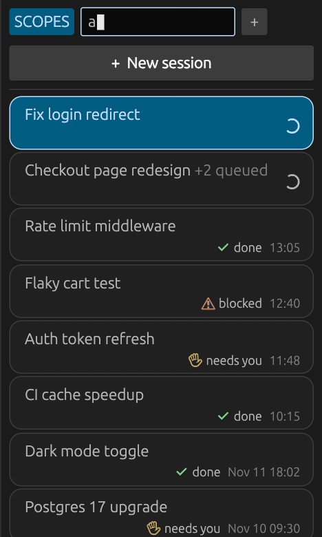
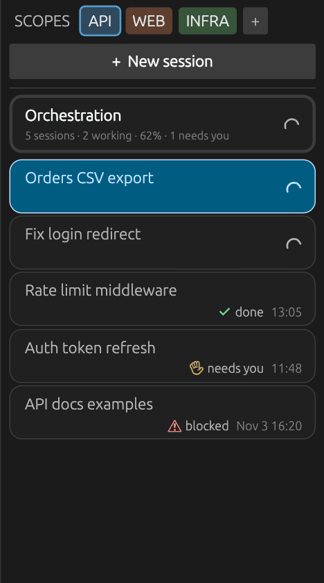
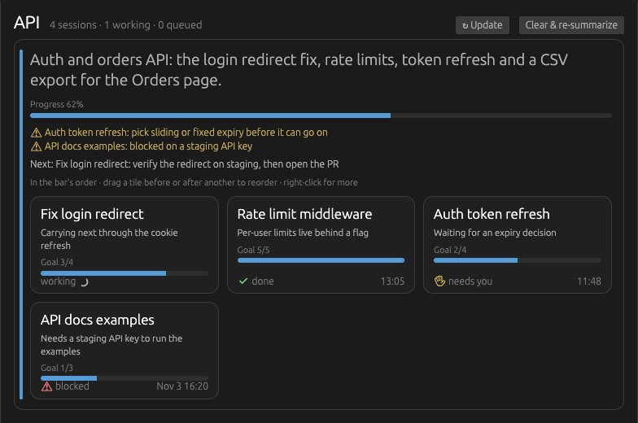
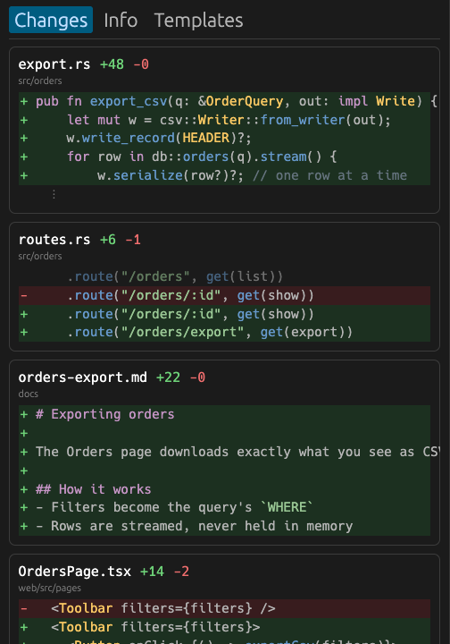
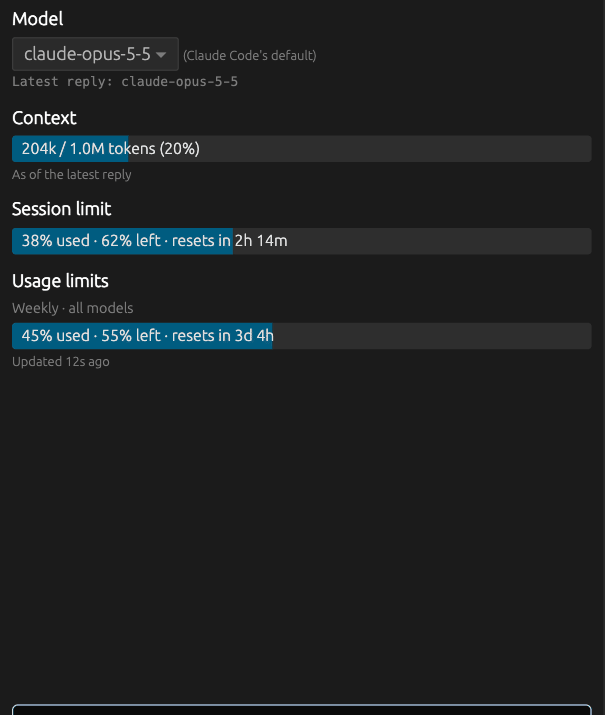
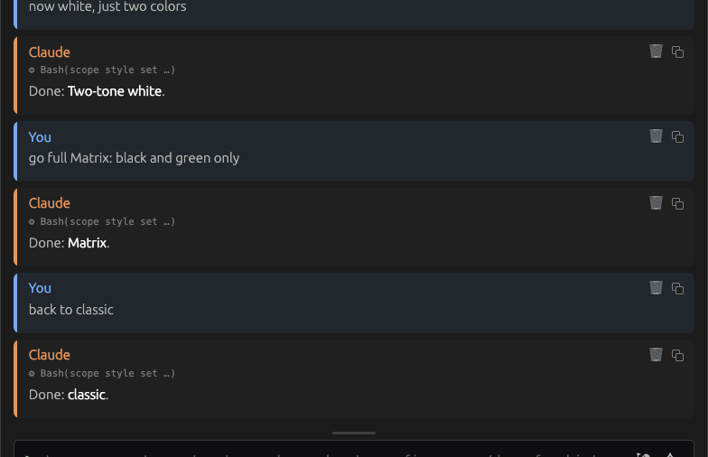
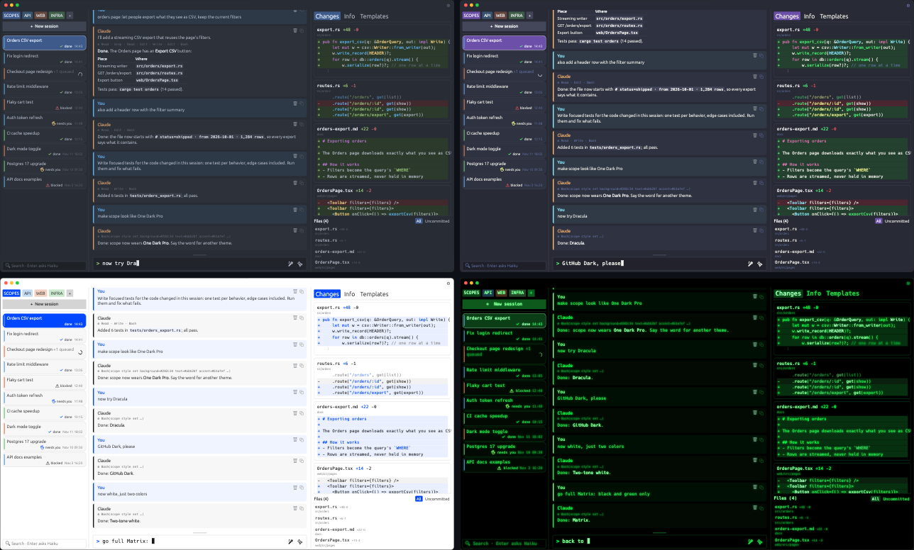
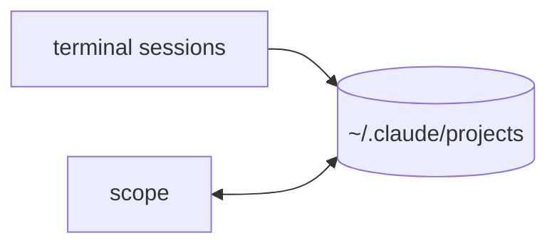

# scope

**Organize your Claude Code sessions by scope, and stop holding all of them in your head.**


scope lets you work with dozens of Claude Code sessions in one organized place, instead of
juggling a pile of terminals in a clunky, overwhelming way. When you run several sessions at
once, the hard part is no longer the code: it is remembering which session was doing what, which one finished, which one is waiting on you, and what each
one changed. Every switch between them costs you a re-read. scope carries that context for
you, so you can direct the work instead of reconstructing it.

```
  terminal 1: claude  "fix the login bug"     <- is it done?
  terminal 2: claude  "add CSV export"        <- waiting for me?
  terminal 3: claude  "refactor the parser"   <- what did it change?
  terminal 4: claude  ???                     <- what was this one about?
```

## How it works

<table>
<tr>
<td width="50%"><br><b>Scopes</b>: group sessions by project, ticket or epic.</td>
<td width="50%"><br><b>Status</b>: working, done, needs you or blocked.</td>
</tr>
<tr>
<td><br><b>Orchestrator</b>: each scope's progress, and what needs you.</td>
<td><br><b>Changes</b>: every edit Claude made, file by file.</td>
</tr>
<tr>
<td><br><b>Ask</b>: side questions with full context. Session untouched.</td>
<td><br><b>Voice + Refine</b>: talk, then get a clear prompt.</td>
</tr>
<tr>
<td colspan="2"><br><b>Themes</b>: ask Claude to restyle it. Anything goes.</td>
</tr>
</table>



**Still Claude Code underneath.** Nothing to migrate.

## Install

Use your terminal one last time. Open Claude Code and paste:

```text
Install this IDE and open it: https://github.com/GuintherKovalski/sessman
```

Needs macOS 11 or later or Windows 10 or later (x64), and [Claude Code](https://docs.claude.com/en/docs/claude-code).

<details>
<summary>Other ways to install</summary>

In a terminal:

```sh
curl -fsSL https://github.com/GuintherKovalski/sessman/releases/latest/download/install.sh | sh
```

It downloads the latest scope (checking its checksum and signature), puts it in /Applications,
downloads the speech model for dictation, installs Claude Code if it's missing, and opens scope.
Run it again any time to update. Or:

- **Homebrew**: `brew install --cask guintherkovalski/scope/scope`
- **By hand**: download `scope-<version>.dmg` from the [latest release](https://github.com/GuintherKovalski/sessman/releases/latest),
  open it and drag scope to Applications.

On **Windows**, in PowerShell:

```powershell
irm https://github.com/GuintherKovalski/sessman/releases/latest/download/install.ps1 | iex
```

It does the same: downloads `scope-windows-x64.zip` (checking its checksum), puts `scope.exe` in
`%LOCALAPPDATA%\Programs\scope`, adds it to your PATH and the Start menu, downloads the speech
model, installs Claude Code if it's missing, and opens scope. Or unzip `scope-windows-x64.zip`
from the [latest release](https://github.com/GuintherKovalski/sessman/releases/latest) anywhere
and run `scope.exe`. It isn't code-signed yet, so SmartScreen may ask you to confirm the first
run (**More info → Run anyway**).

That's all: nothing to compile, no Rust or cmake. scope updates itself (both platforms): when a new version is
out, the top bar says so, and **Settings → About** installs it and restarts (your sessions keep
running). Installed another way, dictation (🎤) offers to download its speech model (about
150 MB) the first time you use it; the first recording asks for microphone access.

</details>

## Features

**Sessions and scopes** (left)
- **+ New session** picks a folder and opens an empty session; the first prompt creates it.
  Model, permissions, thinking, MCP servers, skills, agent, hooks and plugins can be picked
  for it from dropdowns.
- Sessions newest first, refreshed on their own, each with its state (working, queued
  prompts, done / needs you / blocked). Double-click to rename.
- Scope tabs: **+** to create; drag sessions onto a tab or right-click → **Move to**; drag
  tabs to reorder; right-click a tab to rename, recolor or delete it.
- Inside a scope, drag sessions to arrange them (**Sort newest first** undoes it).
  Shift-click, Cmd-click or a drawn box picks several, to move, remove or trash at once.
  Delete takes sessions out of the scope; **Cmd+Z** puts them back.
- Up / Down walk the list once a session is clicked; typing goes to the prompt.
- **Search**: filters by name, then goal, then conversation text; **Enter** asks Haiku to
  find sessions matching a description.

**Overview and orchestration** (main area)
- **SCOPES** overview: a card per scope (its purpose, Jira tickets, a tile per session with
  what it is doing and what it needs), most recently active first. Long-idle sessions offer
  **Finish session**.
- The **◆ Orchestration** bubble at the top of each scope shows its progress and opens its
  page: summary, **Needs you**, **Next**, session cards you can reorder and rename, links to
  every session mentioned, and an **Ask** field. **Clear & re-summarize** starts over.
- **Processes**: what each working session is running, as a tree, with a stop button per row.

**Conversation and prompt** (center)
- The conversation as Markdown cards: real tables, highlighted code, clickable links, image
  thumbnails. Each card has **Copy** and **🗑** (removes the message from Claude's context).
  Click a message, then Up / Down to read back one message at a time.
- A terminal-style prompt that grows upwards (Shift+Enter for a new line) and can be resized
  or collapsed. Up / Down for this session's earlier prompts. **Cmd+V** pastes images.
- **Enter** sends and streams Claude's progress live. While it works, Enter **queues**
  prompts; **Ctrl+C** stops the run at once and pauses the queue.
- **✨ Refine** (Cmd+Enter or Cmd+R) rewrites the prompt with a helper model, asking
  skippable questions when it is ambiguous. **🎤** dictates, transcribed locally with Whisper.
- Several sessions run at once; switching back to a working one keeps streaming.
- Files open read-only in tabs that belong to their session; `.md` files open rendered.
  **Cmd+F** finds text in the conversation or the open file.

**Changes, Info and Templates** (right)
- **Changes**: every edit Claude made, grouped by file with syntax-highlighted diffs; click a
  file to filter, double-click to open it.
- **Info**: the goal and its subgoal checklist, the model (switchable between runs), context
  usage, your 5-hour and weekly limits, and **Ask about this goal** (a side question that
  doesn't touch the session).
- **Templates**: the scope's prompt templates, skills and commands (yours and every
  subproject's). **Use in prompt** inserts one; **✨ Create template** has Claude write a new
  one, and `@[session]` turns what a session did into a reusable prompt.

**Everywhere**
- **Settings** (⚙ or Cmd+,): appearance and style presets, prompt input, Claude command and
  models, behaviour, and every helper's **harness** (the instructions it starts from, editable,
  with the full prompt it sends).
- **Driven by commands**: `scope list | rename | move | new | ask | style` run against the
  open app, from a terminal or from any Claude session.
- **Restart-proof**: scopes, open session, tabs, drafts, queues and layout come back after a
  restart, and runs keep going while scope is closed.
- **Several windows** on the same config stay in sync within half a second.
- **Updates itself**: the top bar says when a new version is out; Settings → About installs it
  and restarts without ending your sessions.

## Build from source

Needs [Rust](https://rustup.rs) and `brew install cmake` (it builds the Whisper engine,
whisper.cpp with Metal, for dictation).

```sh
cargo run --release
cargo test
scripts/bundle.sh     # builds scope.app with its icon into ~/Applications (or a dir you pass)
scripts/release.sh    # the release files (universal .dmg and .zip) into dist/
```

Pin `~/Applications/scope.app` in the Dock, not `target/release/scope`: a bare binary shows
the generic executable icon whenever the app isn't running.

**On Windows**: [Rust](https://rustup.rs) with the MSVC toolchain (Visual Studio Build Tools,
"Desktop development with C++"), [CMake](https://cmake.org/download/) and
[LLVM](https://github.com/llvm/llvm-project/releases) (whisper.cpp's bindings need libclang),
then `cargo run --release` or `cargo build --release` for `target\release\scope.exe`. The
e2e tests that start runs outside the app or stop processes use `sh`, `pgrep` and `pkill`, so
they run on macOS only; CI runs the rest of the suite on Windows too. The scripts in `scripts/`
are POSIX shell (Git Bash runs most of them; `bundle.sh` and `release.sh` are macOS's).

**Testing changes**: always in a new instance of scope, never the one running your sessions
(restarting it ends them): `scripts/test-instance.sh start`, then `stop`. See
[CLAUDE.md](CLAUDE.md). Several features at once, each with its own worktree, build and test
window: `scripts/feature.sh`, see [WORKTREES.md](WORKTREES.md). Taking changes live without a restart is on the
[roadmap](ROADMAP.md#13-live-changes-scope-updates-without-ending-its-sessions).

**Releasing**: `scripts/flow.sh release 0.2.0`; CI builds, signs, notarizes and publishes it.
The one-time setup (Developer ID certificate, secrets, Homebrew tap) is in [RELEASING.md](RELEASING.md).

Linux is not supported yet. Everything that differs between macOS and Windows is in
`src/platform.rs` (home folder, opening files, finding `claude`, listing and stopping
processes), plus a few `cfg(windows)` blocks next to their macOS counterparts (folder picker,
Recycle Bin, notifications, clipboard images, updates).

Specs, plan, and tasks are in `specs/001-session-manager-ui/` (Spec Kit). The open questions to
settle by using the app are in `research.md`.

## Gaps

Known shortcomings of what's already built, to pick up as Spec Kit features later.

### Windows

- **Stop ends a run instead of interrupting it.** Windows has no Ctrl+C for a program without a
  console window, so ⏹ and Ctrl+C end `claude` and everything it started at once. Claude Code
  saves each step as it goes, so nothing finished is lost, but the session gets no
  "Interrupted" marker. The same goes for the Processes tab's stop buttons.
- **Clicking a notification doesn't open its session.** They are toasts posted through
  PowerShell, which can't call back into scope.
- **HEIC images** (iPhone photos) can't be pasted or dropped; macOS converts them with `sips`.
- **Pasting images** checks Ctrl+V itself (egui ignores a paste with no text in it), so pasting
  with Shift+Insert only takes text.
- **Not code-signed**: SmartScreen may warn on first run; updates are checked against the
  release's `SHA256SUMS` instead of a signature.

### Markdown rendering (`specs/010-markdown-rendering-themes/`)

- **Table cells can't be selected.** Tables are drawn by hand (to get column alignment and
  sideways scrolling), so their text can't be selected or copied like the rest of a message.
- **Only the first link in a table cell opens.** Links in cells are colored and underlined,
  but clicking anywhere in the cell opens its first link; a cell with several links can't
  open the others.
- **Opening a session draws every message once.** Off-screen messages are skipped only after
  their height is known, so the first frame after opening (or reloading, or resizing) a
  session draws all of them. It may stutter briefly on very long sessions.

### Search and live progress (`specs/011-search-live-progress-multiline/`)

- **Content search needs exact words.** Typos are tolerated in names and goals, but words
  inside conversations must appear as typed (case-insensitive).
- **Content search can lag up to 10 s.** The index is rebuilt in the background; text from the
  last few seconds of another session may not be found yet.
- **Haiku search sees only the 40 most recent sessions**, and only their names, goals and
  first three prompts, not the whole conversation.
- **Sub-agent work isn't shown live.** While a sub-agent (Task tool) runs, only its tool line
  shows; its own steps don't stream in.
- **Switching back to a running session can show a step twice** until the run ends (the step
  was already on disk when the session reloaded and then arrived from the stream too); the
  reload at the end of the run fixes it.

### Roadmap rounds 1–4 (`specs/012-roadmap-rounds-1-4/`)

- **Testing with synthetic key events**: modifier keys sent by System Events (e.g. Shift+Enter)
  sometimes arrive without the modifier, so automated UI checks use CGEvents with explicit
  flags. Real keyboards are not affected.
- **A few symbols** (→, ▾) are missing from egui's default font and render as boxes; scope
  avoids them in its own text (the input's collapse triangle is drawn), but they still show
  as boxes inside conversations that contain them.
- **A stopped run may add a "No response requested." reply** the next time the session runs:
  that comes from Claude Code itself, after its interrupt marker.
- **Selecting a very long session briefly blocks the window** while it loads (sessions are
  read on the UI thread).

See [PROJECT.md](PROJECT.md) for a full explanation of the app, how it works, and how it is built.
